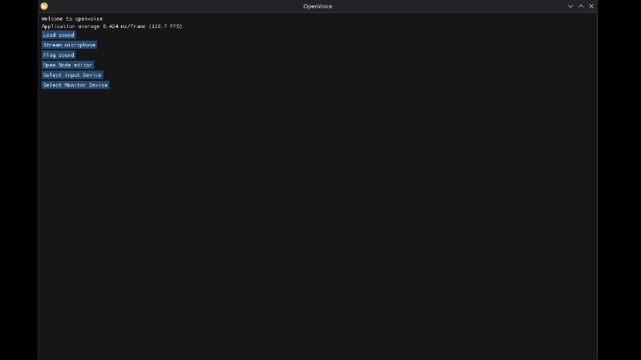

# OpenVoice



OpenVoice is a free and opensource real time voicechanger for desktops on all platforms. It is made purely in C++.

The goal, make a simple to use app that is linked to a database of voice presets (On github) 
so that anyone can use the voice he wants,

without requiring paid subscriptions like certain paid software. 

## What gave me the idea of making this project ? 

I love playing Garry's Mod HL2RP, and when playing as a combine, you have a really hard time trying to setup a vocoder to sound like a true combine. 
Most of the time, you must use a DAW, with many VST's which eat up alot of performance. And people will often recommend you to use paid alternatives

This is why i thought of making this project, as a solution for this problem.

## Features

For the moment, the app is a desktop app for windows and linux. it lets you :
- Play a generic sound to test if your audio output works,
- Select an audio input and output
- Use a node graph to apply effects

## Usage

You must use VB cable on windows or qpwgraph on linux to route audio to your desired app. 

Select an audio input and output in the homepage and then make your node graph setup 

When changing values on nodes, don't forget to update nodes so the changes are applied. 

In the node graph, the exciter is actually your audio input, and the endpoint represents your audio output. 
You can start by linking them to hear your beautiful voice, by simply holding left mouse button on the output pin of the exciter,
and dragging it on the input pin of the endpoint node.

## Credits 

For this project, i used the miniaudio library made by mackron : https://github.com/mackron/miniaudio
I also used the famous https://github.com/ocornut/imgui ImGUI library 
To make the node editor UI, i used https://github.com/thedmd/imgui-node-editor by thedmd. 
It was pretty hard to use, because its undocumented but by reading its code, i was able to work with it. 
For the vocoder node, i used a miniaudio node made by Philip Bennefall, its available in the miniaudio nodes.

## Have i used AI ? 

I sadly had to use AI to finish the project in time for the deadline, more especially, i used AI to make
all the nodes in commit #f96a8e5
 Other than that, i haven't used AI to write code.

But does that mean that i don't understand my code ? of course not, i'm not a vibecoder ! I made sure to not just blindly code and i understand fully the code generated
## Download

Clone the repository:

```bash
git clone https://github.com/samehhhhhhhh/openvoice.git
cd openvoice
```

## Requirements

- C++ compiler (GCC or MinGW-w64)
- [xmake](https://xmake.io/)
- Git

### Windows

1. Install [MSYS2](https://www.msys2.org/).
2. Open the **MSYS2 UCRT64** terminal.
3. Install GCC, Git and xmake:

```bash
pacman -S --needed mingw-w64-ucrt-x86_64-gcc mingw-w64-ucrt-x86_64-git mingw-w64-ucrt-x86_64-xmake
```

### Linux

Install GCC, Git and xmake using your distribution's package manager.

## Build

From the project directory, run:

```bash
xmake
```

To build in Release mode:

```bash
xmake f -m release
xmake
```

## Run

```bash
xmake run openvoice
```


